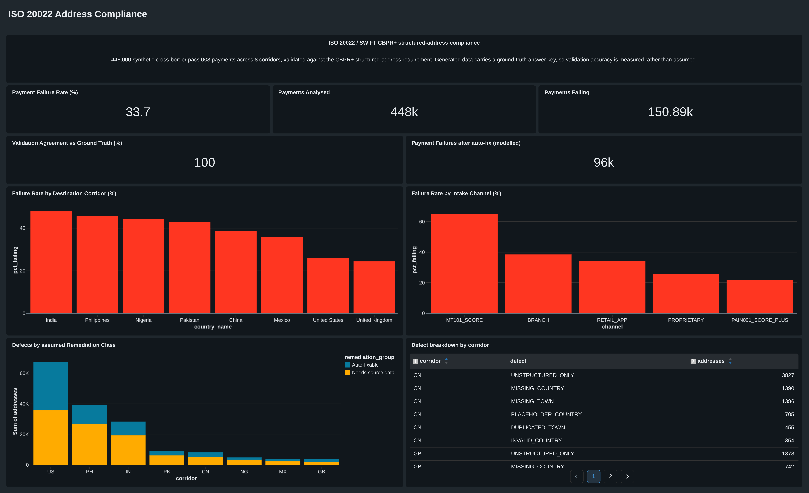

# Cross-Border Payment Data-Quality Pipeline

**ISO 20022 / SWIFT CBPR+ structured-address compliance measurement**

A data pipeline that answers one question a bank has to answer before the CBPR+ structured-address deadline: *what percentage of our cross-border payments would be rejected, and why?*

**33.7% of 448,000 payments carry at least one non-compliant address. The remediation split is modelled, not measured — see Limitations**.




---

## The problem

ISO 20022 migration for cross-border payments completed in November 2025 — MT103 is retired, everything runs on `pacs.008`. But migrating the *message format* is not the same as migrating the *data inside it*.

CBPR+ requires town and country as dedicated structured elements. A fully structured address puts everything in its own element; a *hybrid* address (allowed since SR2025) adds up to two 70-character free-text lines that must not repeat the structured fields. What's being removed is the fully unstructured address — free text only. Swift's own September 2026 data shows **50.2% of debtor and 52.7% of creditor addresses** in CBPR+ `pacs.008` traffic are still fully unstructured. Swift deferred the 14 November 2026 cutoff in August 2026, with an update expected in December — which changes the timeline, not the problem.

A bank facing that deadline needs to know its exposure, where it's concentrated, and what the cheapest remediation is. This pipeline produces those answers from raw `pacs.008` XML.

---

## Architecture

```
  Synthetic generator                 AWS S3                    Databricks
 ┌────────────────────┐      ┌──────────────────────┐    ┌───────────────────────┐
 │ Jinja2 → pacs.008  │      │  bronze/             │    │ bronze_parsed  (Delta)│
 │ XML, 8 corridors,  │ ───► │   ingest_date=…/     │──► │       │               │
 │ 6 defect types,    │      │   897 XML files      │    │       ▼               │
 │ seeded RNG         │      │                      │    │ silver_payments       │
 │                    │      │  Ref_data/           │    │ silver_quarantine     │
 │ + answer key       │ ───► │   answer_key.csv     │    │ silver_dead_letter    │
 └────────────────────┘      └──────────────────────┘    │ silver_recon_exceptions│
                                                         └──────────┬────────────┘
                                                                    │
                                                          ┌─────────▼───────────┐
                                                          │  dbt (Gold)         │
                                                          │  9 models           │
                                                          │  3 seeded dimensions│
                                                          │  7 schema tests     │
                                                          │  3 singular tests   │
                                                          └─────────┬───────────┘
                                                                    │
                                                          ┌─────────▼───────────┐
                                                          │  SQL dashboard      │
                                                          └─────────────────────┘
```

**Bronze** — raw `pacs.008` XML in S3, date-partitioned, never modified. Parsed once into `bronze_parsed` as Delta, because XML isn't splittable and every downstream action would otherwise re-parse it.
**Silver** — flattened to one row per payment, validated, split four ways: clean, quarantine (at least one non-compliant address), dead-letter (unparseable XML), reconciliation exceptions.
**Gold** — Kimball star schema built with dbt. One fact at payment grain, seeded dimensions, reporting views.

---

## Orchestration

An Airflow 3 DAG (`swift_pipeline`, Astro Runtime in Docker) runs the pipeline end to end:

```
silver_parse  >>  dbt_build
```

- `silver_parse` — `DatabricksRunNowOperator` triggering the Silver parsing job on the Databricks cluster.
- `dbt_build` — `BashOperator` running `dbt build` (seed → run → test) against the Databricks SQL warehouse.

**Scheduling** — every three days for this project; daily would be the production cadence. `catchup=False`, because the data is dated August and a backfill would otherwise fire eight months of runs nobody asked for.

**Retries** — three attempts with exponential backoff, five minutes growing to a thirty-minute cap. The Bronze layer makes reruns cheap, so retrying before alerting costs little.

**Alerting** — `on_failure_callback` posts task, DAG, run ID, try number and the error to a Discord webhook. For `dbt_build` the callback reads `target/run_results.json` rather than the task exception, because a failed `dbt build` surfaces to Airflow only as `exit code 1` — the actual failing model or test lives in the artifact. The callback is wrapped so a broken notification can never mask the original failure.

The generator is deliberately **not** orchestrated. It exists to produce a fixed dataset once; scheduling it would be theatre.

---

## Findings

| | |
|---|---|
| Payment-level failure rate | **33.7%** — 150,885 of 448,000 |
| After rule-based remediation | **21.4%** — 95,995 still failing | modelled - see limitations
| Cleared by rules | 54,890 payments, ~36% of failures |
| Worst corridor by rate | India, 47.8% |
| Worst corridor by volume | **United States — 62,709 failures**, more than India and the Philippines combined |
| Worst intake channel | MT101, **64.8%** |
| Best intake channel | pain.001, 21.6% |

**Channel spans a wider range than corridor in this data.** Corridor spans 2× (24.3% – 47.8%); channel spans 3× (21.6% – 64.8%). That's a modelling choice — the generator applies a per-channel offset — but it reflects a real argument: channel is the lever a bank can actually pull.

**Why MT101 is modelled as the worst channel.** MT has no separate tag for town or country; address data lives inside fields `50a` and `59a`. In the free-text option of field 59, the beneficiary address is four 35-character lines, and country is at most a convention on the last line (`/CC/`), not a dedicated element. Translation to ISO 20022 can't turn free text into structured fields. Option `59F` *does* carry country and town, in a `3/CC/Town` line — so MT101's real-world failure rate depends on how often corporates use free text versus `59F`, which isn't published. The 64.8% reflects the assumption that free text dominates.

**Remediation split — modelled, not measured.** Defects were classified as auto-fixable (missing, placeholder or invalid country; duplicated town) or needing source data (missing town; fully unstructured). The 21.4% residual counts the second group. That classification describes a reasonable real-world expectation, but the generated data can't test it — see Limitations.

---

## Design decisions

**The generator library silently dropped the fields this project measures.** The `pacs008` package builds each transaction from a hardcoded field list in `_build_tx_base()`, so postal-address elements passed into it were discarded without an error — the output was valid `pacs.008` XML with no `<PstlAdr>` block at all. Its rendering path was abandoned in favour of driving Jinja2 directly, and the XSD-conformant template extended with `PostalAddress24` elements in the sequence order the schema requires (`StrtNm, BldgNb, PstCd, TwnNm, Ctry, AdrLine` — XSD sequences are order-sensitive, and getting it wrong invalidates the whole file). Silent field-dropping is precisely the failure mode this pipeline exists to detect, so shipping a generator that did the same thing would have been self-defeating.

**The reporting dimension can't live where the failure can.** Grouping by destination country initially dropped 22% of payments — because `MISSING_COUNTRY` and `UNSTRUCTURED_ONLY` destroy the very field being grouped on. Corridor is instead derived from characters 5–6 of the creditor BIC, which is an ISO 3166 country code that no address defect can touch. The cost is honest: a BIC gives the *bank's* jurisdiction, not the beneficiary's location — a Manila beneficiary banking with HSBC Hong Kong reports as Hong Kong. That substitution is the exact thing CBPR+ exists to prevent, and it is used here only because the field it replaces is the field under measurement.

**Failures compound across parties.** A payment needs both addresses clean. Debtor addresses are 88% clean and creditor addresses about 75%, so the payment-level rate (33.7%) is worse than either party's.

**Quarantine is a work queue, not an error log.** Non-compliant payments are still valid payments — they're routed aside for remediation rather than dropped. Dead-letter is separate and holds only genuinely unparseable XML. Reconciliation exceptions get a third table, because a count mismatch has nothing to quarantine and no dead-letter schema to fit.

**Parse the unsplittable format once.** XML can't be split across executors — one file is one task. Landing the parsed output as Delta before any downstream work cut the pipeline from 977s to 56s, because Spark had been re-parsing the XML on every action.

**Dimensions are SCD Type 1.** The remediation classification is a current operational judgement, not a historical fact. If it needed to reflect what was assessed at the time — for audit — Type 2 with effective dates would be correct.

---

## Reconciliation

Two controls, because they catch different failures.

**File-level.** Count the files in Bronze with `binaryFile`, count the distinct `source_file` values the parser produced, compare.

```
Files in Bronze: 897 | Files parsed: 897
```

**Transaction-level.** Every `pacs.008` group header carries `NbOfTxs`, the sender's own count of transactions in the message. Group the Silver rows by `msg_id`, compare the row count to the declared `NbOfTxs`, write any mismatch to `silver_recon_exceptions`.

```
Reconciliation exceptions: 0
```

A truncated or malformed file never parses, so it produces no row and no `NbOfTxs` to compare against — only the file count catches it. A file that parses but silently loses transactions produces rows, and only `NbOfTxs` catches it. Neither control substitutes for the other.

---

## Validation

The generator writes a **ground-truth answer key**: one row per party per payment, recording which defect was planted where. The pipeline never reads it.

Joining the pipeline's labels to the answer key on UETR *and* party:

**896,000 addresses, 100% agreement, zero disagreements.**

What that proves: the validation rules correctly implement the specification. What it does not prove: that the specification is complete — the generator and the validator were written by the same person against the same definition of "broken." On real data, defect types nobody anticipated would appear. The figure's real job is as a regression tripwire: it is asserted as a dbt test, so any change that breaks the rules turns the build red.

The join is checked for grain before the result is trusted. The answer key has two rows per payment; joining on UETR alone would double to 1,792,000 rows and still produce a plausible-looking accuracy number.

**Tests are negative-controlled.** Three singular dbt tests assert the row count (448,000), the failure rate (33.7%) and ground-truth agreement (100%). Each was deliberately broken once and confirmed to fail before being trusted — a green test proves nothing until you have watched it go red.

---

## Stack

| Layer | Tools |
|---|---|
| Generation | Python, Jinja2, seeded RNG |
| Storage | AWS S3, Delta Lake |
| Processing | PySpark, spark-xml, Databricks |
| Transformation | dbt (dbt-databricks) |
| Orchestration | Airflow 3 (Astro Runtime), Docker |
| Governance | Unity Catalog — external locations, grants, table comments |
| Reporting | Databricks SQL dashboard |
| Alerting | Discord webhook via `on_failure_callback` |

---

## Repository

```
generator/            synthetic pacs.008 generator + defect injection
templates/            Jinja2 pacs.008.001.08 template + XSD
pipeline/             PySpark Bronze → Silver
airflow/
  dags/
    swift_pipeline.py   DAG: silver_parse >> dbt_build
  include/
    swift_gold/         dbt project (single source of truth, mounted into the container)
      models/             9 models + sources + schema tests
      seeds/              3 dimension CSVs
      tests/              3 singular tests
docs/                 session notes — one per working session, with decisions and alternatives
```

The dbt project lives under `airflow/include/` rather than the repo root so that the Airflow container and a local `dbt` run use the same files. Astro mounts `include/` at `/usr/local/airflow/include/`.

---

## Running it

**Generate the data**

```bash
cd generator
python step2.py          # writes data/bronze/ and data/answer_key.csv
```

**Bronze → Silver** — run `pipeline/silver_parsing.py` as a Databricks notebook (or the registered job) against a Unity Catalog external location pointing at the bucket.

**Gold, standalone**

```bash
cd airflow/include/swift_gold
dbt build --profiles-dir .       # seed → run → test
dbt docs generate && dbt docs serve
```

**Everything, orchestrated**

```bash
cd airflow
astro dev start                  # Airflow UI at localhost:8080
```

Requires:
- `.env` with `DBT_DATABRICKS_TOKEN` and `DISCORD_WEBHOOK_URL` — read at container start, so `astro dev restart` after any change.
- An Airflow connection `databricks_default` (host + personal access token).
- The Databricks job ID in `swift_pipeline.py` pointing at the Silver parsing job.

Databricks personal access tokens expire. When the DAG fails with `403 Invalid access token`, the token needs regenerating in three places: the Airflow connection, `.env`, and `~/.dbt/profiles.yml`.

---

## Data provenance

The payments are synthetic. Corridor weights are **derived from** — not matched to — Statistics Canada's 2018 Study on International Money Transfers and Payments Canada's international payments survey. SIMT reports value, so implied payment counts were obtained by dividing corridor value by the average transfer size for that region. The US share is anchored to the Payments Canada figure, because SIMT surveys only people born in ODA-eligible countries and therefore excludes US-born senders almost entirely.

Defect rates per corridor and per channel are similarly derived, with the channel model applying an additive offset to the corridor baseline.

---

## Limitations

**The synthetic data is cleaner than real traffic.** Swift's September 2026 CBPR+ data shows about half of addresses fully unstructured, 12–20% hybrid and up to 14% with no address; this generator plants far fewer unstructured addresses and no hybrid or address-less parties. Defect rates are assumptions — only format shares are published. The six planted defect types cover the main format failures; untested format failures include line-count and town-length limits, non-Latin characters and address-less parties. The research also lists data-quality defects that pass format checks.

**The remediation split is modelled, not measured.** Every planted defect is reversible by construction — `MISSING_TOWN` keeps a postcode that maps to exactly one town, and `UNSTRUCTURED_ONLY` writes a clean `{town} {postcode}` line — so the 21.4% is a count of labels, not a recovery rate. Real recovery is much harder: the best published parser scores 0.801 F1 on real SWIFT addresses. v2 adds a recovery step scored against the answer key.

**Validation gaps the data never exercises.** Duplicate-town detection is exact-match (real duplication is a substring); an address with no town, country or lines falls through to `CLEAN`; the hybrid two-line cap isn't enforced; and with one defect per party, the `when()` precedence is never tested. `PLACEHOLDER_COUNTRY` also writes `NOTPROVIDED` into `Ctry`, which fails the schema — the XSD validator is imported but never called.

**Other simplifications.** Amounts are uniform rather than calibrated; corridor weights merge two surveys with different units; one BIC per corridor; defect rates are flat over time; full refresh rather than incremental `MERGE`, which production volume and a stateful quarantine would need.
